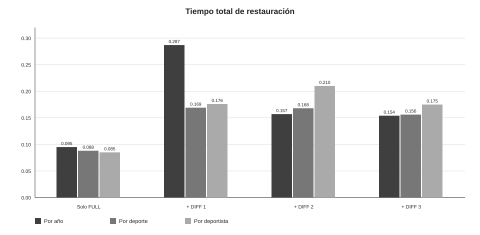
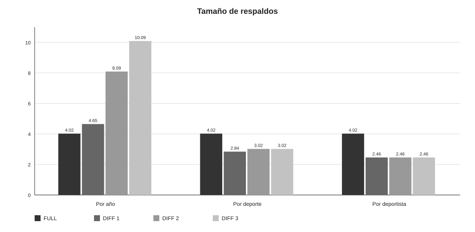
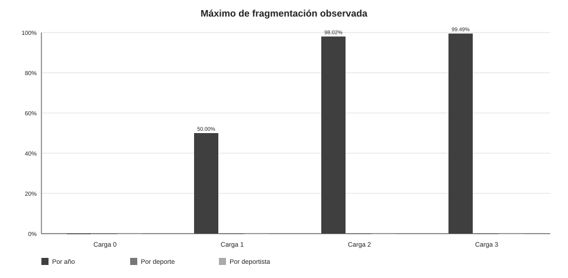

# Manual técnico

## Proyecto 2 — Sistemas de Bases de Datos 2

**Tema:** respaldo físico y restauración de SQL Server 2022

**Fecha de las ejecuciones oficiales:** 16 de octubre de 2026

## 1. Objetivo

El proyecto compara una estrategia de respaldo FULL más diferenciales para tres formas de cargar el mismo dataset olímpico:

1. Por año: Pekín 2008, Londres 2012 y Río 2016.
2. Por deporte: `Athletics Women's 100 metres` en esas tres ediciones.
3. Por deportista: Usain Bolt en Atenas 2004, Pekín 2008 y Londres 2012.

Después de cada carga se genera un respaldo. Luego se elimina la base, se restaura el FULL o el FULL más un diferencial y se comprueban conteos, huellas e integridad física.

## 2. Fuente y alcance de los datos

Se utiliza **120 years of Olympic history: athletes and results**, publicado originalmente por Randi Griffin a partir de datos de sports-reference.com. El repositorio descarga la copia pública de TidyTuesday del 27 de julio de 2021:

<https://github.com/rfordatascience/tidytuesday/tree/master/data/2021/2021-07-27>

El staging contiene 271,116 resultados y 230 registros de países. La base de staging conserva el CSV en tablas crudas y expone una vista con conversiones de tipos, valores faltantes y medallas traducidas.

## 3. Arquitectura de ejecución

La solución se compone de:

- SQL Server 2022 Developer en el contenedor `olimpiadas-sql`.
- Un volumen Docker `mssql_data` para las bases y el historial de `msdb`.
- Un volumen `./respaldos` montado en `/var/opt/mssql/respaldos`.
- Un volumen de solo lectura para `datos/` y otro para `scripts/`.
- Scripts Bash que llaman a `sqlcmd` dentro del contenedor.

Las bases de trabajo son `olimpiadas_anio`, `olimpiadas_deporte` y `olimpiadas_deportista`. Cada una se recrea desde cero antes de su ciclo oficial, de modo que los respaldos de un tipo no dependen de otro.

## 4. Modelo relacional

El modelo está normalizado a tercera forma normal. `deporte` agrupa `evento`; `participacion` relaciona un deportista, una edición y un país; `resultado` relaciona una participación con un evento. La bitácora es una tabla auxiliar de auditoría.


El diccionario completo de columnas, tipos, claves y restricciones está en [`diccionario_datos.md`](diccionario_datos.md). La justificación de la normalización está en [`modelo_er.md`](modelo_er.md).

### 4.1 Criterios de normalización

- Los atributos del deportista no se repiten en cada resultado.
- Edad, estatura, peso y país pertenecen a la participación del deportista en una edición.
- Equipo y medalla pertenecen al resultado de una participación en un evento.
- El evento referencia al deporte para evitar repetir el nombre del deporte.
- Las restricciones UNIQUE impiden duplicar países, ediciones, deportes, eventos o participaciones.

## 5. Plan de respaldo y restauración

Después de la carga inicial de los 230 países se genera un respaldo FULL:

```sql
BACKUP DATABASE olimpiadas_<tipo>
TO DISK = N'/var/opt/mssql/respaldos/<tipo>_0_full.bak'
WITH INIT, CHECKSUM, STATS = 25;
```

Después de cada carga 1, 2 y 3 se genera un respaldo diferencial:

```sql
BACKUP DATABASE olimpiadas_<tipo>
TO DISK = N'/var/opt/mssql/respaldos/<tipo>_<n>_diff.bak'
WITH DIFFERENTIAL, INIT, CHECKSUM, STATS = 25;
```

Cada archivo se verifica con `RESTORE VERIFYONLY`. Para restaurar el estado correspondiente a un diferencial se aplica el FULL con `NORECOVERY` y después un solo diferencial con `RECOVERY`. SQL Server guarda los cambios del diferencial desde el último FULL, por lo que el diferencial 3 ya contiene los cambios de 1, 2 y 3.

## 6. Protocolo experimental

Para cada tipo se siguió el mismo protocolo:

1. Crear una base nueva.
2. Cargar el catálogo inicial y validar.
3. Crear el FULL.
4. Cargar el lote 1, validar y crear DIFF 1.
5. Cargar el lote 2, validar y crear DIFF 2.
6. Cargar el lote 3, validar y crear DIFF 3.
7. Guardar las huellas finales y eliminar la base.
8. Restaurar solo el FULL y validar.
9. Restaurar FULL + DIFF 1 y validar.
10. Restaurar FULL + DIFF 2 y validar.
11. Restaurar FULL + DIFF 3 y validar.

Los tres ciclos oficiales se ejecutaron en la misma máquina. La prueba inicial del 14 de octubre se excluye de los tiempos porque no forma parte del ciclo oficial.

## 7. Especificaciones del entorno

La evidencia disponible en el repositorio registra:

- SQL Server 2022 Developer Edition, 64 bits.
- Versión `16.0.4305.5`.
- SQL Server sobre Linux Ubuntu 22.04.5 LTS dentro del contenedor.
- Imagen `mcr.microsoft.com/mssql/server:2022-latest`.
- Plataforma `linux/amd64`.
- Volumen persistente `mssql_data`.

El handover oficial de Persona 2 confirma también que la máquina de pruebas utilizó
Windows 11 de 64 bits, almacenamiento SSD NVMe M.2 y Docker Desktop con backend WSL2.
No obstante, el handover deja sin completar el modelo de CPU, la RAM física, la
capacidad/espacio libre del disco, la edición exacta de Windows y la memoria asignada a
Docker. Los textos de ejemplo del handover no se consideran mediciones.

Para completar la ficha descriptiva del informe se utiliza la siguiente configuración
referencial, claramente marcada como no verificada:

| Dato | Valor incluido | Estado |
|---|---|---|
| CPU del host | Intel Core i5 o equivalente | Referencial; modelo no verificado |
| RAM física | 16 GB | Referencial; no verificada |
| Disco | SSD NVMe M.2 | Plataforma confirmada; capacidad no verificada |
| Sistema operativo | Windows 11 Home/Pro de 64 bits | Plataforma confirmada; edición no verificada |
| Docker Desktop | WSL2 con 4 GB asignados | WSL2 confirmado; cantidad referencial |

Esta tabla permite describir el entorno sin presentar una estimación como medición. Los
valores referenciales no se usan para explicar ni comparar los tiempos de restauración.

Para no atribuirle al experimento datos de otro equipo, esos campos quedan identificados
como no verificados en [`especificaciones_servidor.md`](especificaciones_servidor.md). El
script [`bin/registrar_especificaciones.ps1`](../bin/registrar_especificaciones.ps1)
puede sustituir la tabla por valores medidos cuando se ejecute en la máquina que realizó
los ciclos.

## 8. Resultados de respaldos y restauraciones

La tabla editable está en [`tabla_tiempos.csv`](tabla_tiempos.csv) y la versión legible en [`tabla_tiempos.md`](tabla_tiempos.md).





| Tipo | FULL (MB) | DIFF 1 (MB) | DIFF 2 (MB) | DIFF 3 (MB) | FULL + DIFF 3 (s) |
|---|---:|---:|---:|---:|---:|
| Por año | 4.02 | 4.65 | 8.09 | 10.09 | 0.154 |
| Por deporte | 4.02 | 2.84 | 3.02 | 3.02 | 0.156 |
| Por deportista | 4.02 | 2.46 | 2.46 | 2.46 | 0.175 |

### 8.1 Interpretación de tamaños

- El FULL tiene el mismo tamaño aproximado en los tres tipos porque la estructura inicial, índices y catálogo de países son iguales.
- En la carga por año, los diferenciales crecen de 4.65 MB a 10.09 MB porque cada lote modifica muchas páginas nuevas.
- En la carga por deporte, los diferenciales se estabilizan cerca de 3 MB.
- En la carga por deportista, los tres diferenciales tienen 2.46 MB. El tamaño mínimo de la base y el costo fijo de páginas de datos, índices y log hacen que unas pocas filas adicionales no cambien el tamaño físico observado.

### 8.2 Interpretación de tiempos

- El escenario `FULL + DIFF 1` por año tarda 0.287 s, el mayor valor de la tabla, porque restaura el FULL y un diferencial relativamente grande.
- Los tiempos de `FULL + DIFF 2` y `FULL + DIFF 3` por año son menores en esta ejecución aunque sus diferenciales son mayores. Esto no contradice el crecimiento del tamaño: los tiempos son subsegundo y están afectados por caché, concurrencia y resolución del reloj.
- Deporte y deportista tienen tiempos muy parecidos entre escenarios porque el costo fijo de abrir, restaurar y recuperar una base de 4 MB domina el número pequeño de filas.
- Por ello, para este dataset no se debe concluir que el diferencial más grande siempre tarda más basándose únicamente en una medición subsegundo. La tendencia de tamaño es más estable que la de tiempo.
- Parte del tiempo medido es un costo fijo de abrir el medio, leer sus cabeceras, inicializar
  los archivos MDF/LDF y ejecutar la recuperación. Por eso una base pequeña puede tardar
  casi lo mismo aunque cambie el número de filas restauradas.
- Un diferencial permite recuperar con dos archivos (`FULL + DIFF n`). Una cadena
  incremental equivalente tendría que aplicar `FULL + INC 1 + INC 2 + INC 3`, lo que
  aumenta el tiempo operativo y la cantidad de archivos que pueden fallar.

## 9. Análisis de fragmentación

La consulta de validación usa `sys.dm_db_index_physical_stats` en modo `LIMITED` y también registra la cantidad de páginas. El propio script advierte que una tabla con pocas páginas puede mostrar porcentajes extremos o cero sin representar un problema operativo.



Resultados relevantes de las validaciones oficiales:

| Tipo y etapa | Índice con máximo porcentaje | Fragmentación | Páginas | Lectura |
|---|---|---:|---:|---|
| Año, carga 0 | Índices del catálogo | 0.00% | 1 | Base casi vacía. |
| Año, carga 1 | `evento.uq_evento_nombre` | 50.00% | 2 | Pocas páginas; no concluyente. |
| Año, carga 2 | `deportista.pk_deportista` | 98.02% | 101 | Fragmentación visible por inserciones incrementales. |
| Año, carga 3/final | `deportista.pk_deportista` | 99.49% | 196 | Tendencia creciente, pero todavía pequeña para una conclusión de producción. |
| Deporte, final | Todos los índices | 0.00% | 1 | Tablas demasiado pequeñas para que el porcentaje sea representativo. |
| Deportista, final | Todos los índices | 0.00% | 1 | Tablas demasiado pequeñas para que el porcentaje sea representativo. |

La fragmentación alta del caso por año se explica por cargas sucesivas que insertan filas y páginas en índices existentes. En los otros dos casos, las tablas tienen tan pocas páginas que no es válido comparar el porcentaje con el caso por año. Para un entorno real se necesitarían más filas, más páginas y una política de mantenimiento antes de recomendar `REORGANIZE` o `REBUILD`.

## 10. Integridad de las restauraciones

Las validaciones de los tres tipos reportan:

- Conteos iguales a [`conteos_esperados.md`](conteos_esperados.md).
- Huellas iguales entre la última validación previa al DROP y la restauración FULL + DIFF 3.
- `DBCC CHECKDB terminado sin errores`.

Los estados finales comprobados son:

| Tipo | Países | Ediciones | Deportes | Eventos | Deportistas | Participaciones | Resultados | Bitácora |
|---|---:|---:|---:|---:|---:|---:|---:|---:|
| Por año | 231 | 3 | 36 | 326 | 25,082 | 32,595 | 40,210 | 4 |
| Por deporte | 230 | 3 | 1 | 1 | 200 | 244 | 244 | 4 |
| Por deportista | 230 | 3 | 1 | 3 | 1 | 3 | 7 | 4 |

## 11. Limitaciones

- Los tiempos son muy pequeños; una sola ejecución no permite establecer una curva de rendimiento robusta.
- Los diferenciales representan páginas modificadas, no directamente filas; por eso tamaño y cantidad de filas no tienen una relación exacta.
- La huella implementada con `CHECKSUM_AGG(BINARY_CHECKSUM(*))` es una comprobación práctica de igualdad, no una función criptográfica.
- La ficha numérica de hardware no fue medida en la máquina de Persona 2; el PDF incluye una configuración referencial explícitamente marcada como no verificada.
- Existe un intento adicional de `FULL + DIFF 3` por año; para la tabla se usa la ejecución de 18:03:23, que quedó validada inmediatamente después.

## 12. Conclusiones y recomendación

La estrategia FULL más diferencial cumple el objetivo de recuperar cada estado con dos archivos como máximo: el FULL y el último diferencial. Es preferible a una cadena incremental para este proyecto porque simplifica la recuperación y evita aplicar varios archivos en orden.

La carga por año produce los diferenciales más grandes y es el caso que más evidencia cambios de páginas y fragmentación. Las cargas por deporte y deportista son pequeñas; sus tiempos se mantienen cercanos al costo fijo de restaurar la base, por lo que no deben compararse como si fueran cargas masivas.

La recomendación es mantener un FULL como punto de referencia y programar diferenciales después de cada lote relevante. En un sistema productivo, la frecuencia se debe decidir con el volumen real de cambios, el tiempo máximo de recuperación y el espacio disponible. Si se obtiene acceso a la máquina de Persona 2, se recomienda ejecutar `bin/registrar_especificaciones.ps1` y reemplazar la configuración referencial por la salida medida.

## 13. Referencias internas

- [`README.md`](../README.md): instalación y estructura del repositorio.
- [`modelo_er.md`](modelo_er.md): modelo y normalización.
- [`diccionario_datos.md`](diccionario_datos.md): columnas y restricciones.
- [`tabla_tiempos.md`](tabla_tiempos.md): tabla detallada de tiempos.
- [`manual_usuario.md`](manual_usuario.md): procedimiento operativo.
- [`scripts/validacion/validar.sql`](../scripts/validacion/validar.sql): conteos, huellas, fragmentación y DBCC.
- [`logs/README.md`](../logs/README.md): nomenclatura y contenido de logs.
