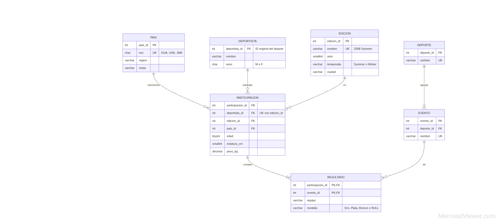

# Modelo entidad-relación

Tabla auxiliar (no forma parte del modelo de negocio): `BITACORA_CARGA (carga_id PK, fecha_hora, tipo, descripcion, filas_fuente, filas_insertadas, duracion_ms)`. Registra cada carga y permite comprobar, después de restaurar, qué cargas contiene la base.

## Justificación de la normalización (3FN)

- **DEPORTISTA**: nombre y sexo dependen solo del deportista, así que no se repiten en cada evento.
- **PARTICIPACION**: edad, estatura, peso y país dependen del deportista *en una edición*, no de cada evento. Por eso van en una tabla con clave única (deportista, edición).
- **RESULTADO**: el equipo y la medalla dependen de la participación *en un evento*. Por ejemplo, en relevos el equipo puede ser "United States-1".
- **EVENTO → DEPORTE**: el deporte depende del evento. Se separa para evitar una dependencia transitiva.
- **EDICION**: año, temporada y ciudad dependen de la edición ("2008 Summer").
